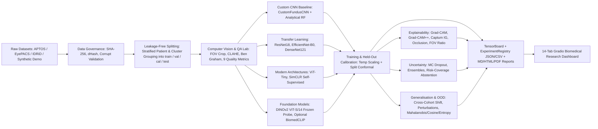

# RetinaX — A Research-Driven Framework for Robust and Trustworthy Retinal Image Intelligence

[](https://huggingface.co/spaces/yashiiiiii/retinax)
[](https://yashi-2004.github.io/retinax/)
[](https://github.com/yashi-2004/retinax/actions/workflows/ci.yml)
[](LICENSE)
[](pyproject.toml)

> **CLINICAL SAFETY DISCLAIMER:** RetinaX is an academic research prototype. It is not a clinically validated diagnostic system and must not be used to diagnose disease, determine treatment, or replace professional ophthalmic assessment.

---

## 1. Project Overview

**RetinaX** is a self-contained, zero-cost, CPU-compatible medical computer vision research platform designed to study automated **Diabetic Retinopathy (DR)** severity grading across the full progression of modern visual intelligence:

**Classical Image Processing $\rightarrow$ Neural Network Fundamentals $\rightarrow$ Convolutional Neural Networks $\rightarrow$ Transfer Learning $\rightarrow$ Vision Transformers $\rightarrow$ Self-Supervised Learning $\rightarrow$ Vision Foundation Models $\rightarrow$ Explainable AI $\rightarrow$ Uncertainty Quantification $\rightarrow$ Domain Generalisation.**

Rather than optimizing a single leaderboard accuracy number, RetinaX functions as an integrated biomedical computer vision laboratory featuring deterministic data governance, fundus-aware quality analysis, multi-regime model training, held-out calibration and conformal uncertainty estimation, post-hoc visual attribution diagnostics, cross-dataset shift evaluation, automated Markdown/HTML/PDF research report generation, TensorBoard telemetry, and a 14-tab local Gradio dashboard.

---

## 2. Research Motivation

Automated retinal screening from fundus photography offers substantial potential to detect vision-threatening pathology (microaneurysms, haemorrhages, hard exudates, cotton-wool spots, venous beading, and neovascularisation). However, translating high-accuracy benchmarks into dependable screening tools fails on seven recurring scientific challenges:

1. **Severe Class Imbalance:** Most images depict Healthy (`No DR`) or `Mild`/`Moderate` grades, while urgent `Severe` and `Proliferative DR` grades are sparse.
2. **Acquisition Quality Variation:** Defocus blur, cataract haze, uneven vignetting, under/overexposure, and field-of-view truncation degrade signal.
3. **Limited Labelled Clinical Data:** Fine-grained expert grading is expensive, motivating data-efficient transfer, self-supervised, and foundation representations.
4. **Domain & Camera Shift:** Models trained on one clinical camera cohort (e.g., APTOS 2019) experience calibration drift and accuracy drops on unseen populations (e.g., EyePACS).
5. **Overconfident Errors:** Standard softmax layers assign high confidence to out-of-distribution (OOD) inputs, borderline grades, and ungradable images.
6. **Confounding Shortcuts & Opaque Predictions:** Deep models frequently exploit non-retinal bezel borders or brightness artifacts unless audited spatially.
7. **Evaluation Leakage:** Duplicate or same-patient fellow-eye images leaking across splits inflate reported accuracy artificially.

---

## 3. Problem Statement & Proposed Research Study

**Working Paper Title:**
> *Towards Reliable Retinal Disease Grading: A Comparative Study of Convolutional Neural Networks, Self-Supervised Representations and Vision Foundation Models under Dataset Shift*

### Central Research Question
> Can data-efficient deep learning and modern visual foundation-model representations improve retinal disease grading while maintaining reliable uncertainty estimates and generalisation across imaging datasets?

### Ten Supporting Research Questions
1. How do conventional CNNs compare with pretrained CNNs and Vision Transformers?
2. Does transfer learning improve performance when labelled training data is limited?
3. Can self-supervised visual representations improve downstream classification?
4. Do pretrained foundation-model embeddings generalise better than task-specific CNN representations?
5. How does image-quality variation affect classification performance?
6. Can Grad-CAM identify meaningful retinal regions associated with model predictions?
7. Can uncertainty estimation identify potentially unreliable predictions?
8. How well do models generalise to an external retinal imaging dataset?
9. Does calibration improve the reliability of model confidence?
10. Can a model abstain from making predictions when confidence is insufficient?

---

## 4. Architecture Diagram



### Repository Structure
```text
project 4/ (RetinaX)
├── app/
│   ├── main.py                      # Gradio Blocks entrypoint (14 tabs + safety banner)
│   ├── components/                  # Clinical Navy/Teal theme, shared state, 10-step inference workflow
│   └── pages/                       # 01_overview.py ... 14_research_reports.py
├── configs/
│   ├── default.yaml                 # Default CPU research configuration
│   ├── lightweight_cpu.yaml         # Fast 128x128 CPU preset for Intel Core i5 / 8 GB RAM
│   └── experiments.yaml             # Structured Research Suite A–J definitions
├── src/
│   ├── data/                        # ingestion, synthetic phantoms, validation, manifests, splitting, caching
│   ├── preprocessing/               # fundus_processing, enhancement, augmentation, quality_assessment
│   ├── models/                      # custom_cnn, resnet, efficientnet, vision_transformer, classifier, inference, segmentation_unet
│   ├── foundation/                  # ssl_simclr, dinov2, biomedical_clip, embeddings
│   ├── training/                    # trainer, losses, optimizers, scheduler, checkpoints
│   ├── evaluation/                  # classification, calibration, robustness, generalisation, statistical_tests
│   ├── explainability/              # gradcam, integrated_gradients, visualisation
│   ├── uncertainty/                 # mc_dropout, ensembles, conformal, selective_prediction
│   ├── experiments/                 # reproducibility, tracking, ablation
│   └── reporting/                   # figures, report_generator
├── scripts/                         # prepare_data.py, train.py, run_experiments.py, generate_report.py, run_idrid_segmentation.py, verify_environment.py
├── notebooks/                       # 01_data_and_preprocessing.ipynb, 02_modeling_and_explainability.ipynb
├── docs/                            # 10 in-depth methodology & architecture manuals
├── tests/                           # 17 unit & integration pytest checks
├── .github/workflows/               # GitHub Actions CI, GitHub Pages report site & optional HF Space sync
├── data/, checkpoints/, experiments/, reports/  # Local working storage (.gitignore protected)
├── run.py                           # Root container / Hugging Face Spaces Gradio entrypoint
├── Dockerfile                       # Zero-cost CPU-only Docker container definition
├── LICENSE                          # MIT License
├── pyproject.toml
├── requirements.txt
└── README.md
```

---

## 5. Technology Stack (100% Zero-Cost Local CPU Execution)

| Layer | Libraries & Tools | Notes |
| :--- | :--- | :--- |
| **Deep Learning Core** | `torch>=2.2.0,<2.4.0`, `torchvision`, `timm` | CPU-only compatible; macOS `x86_64` pinned to `torch 2.2.2` + `numpy<2.0`. |
| **Classical Computer Vision** | `opencv-python-headless`, `Pillow`, `albumentations` | FOV detection, Ben Graham filtering, CLAHE, clinical augmentations. |
| **Explainability (XAI)** | Custom hooks (`GradCAMExplainer`), `captum` | Grad-CAM, Grad-CAM++, ViT token reshaping, Integrated Gradients, Occlusion. |
| **Uncertainty & Statistics** | `scipy`, `scikit-learn`, `numpy`, `pandas` | L-BFGS Temperature Scaling, Split Conformal (LAC/APS), Bootstrap CIs, McNemar, JS/KS/Wasserstein. |
| **Optional Extensions** | `monai` (2D U-Net), `open_clip_torch` + `transformers` (BiomedCLIP) | Strictly optional; core system never fails when absent or offline. |
| **UI, Telemetry & Reporting** | `gradio`, `tensorboard`, `matplotlib`, `seaborn`, `fpdf2` | Local 14-tab UI, TensorBoard scalars, publication figures, MD/HTML/PDF reports. |
| **Testing** | `pytest`, `httpx` | Automated unit + end-to-end integration test suite. |

---

## 6. Datasets & Governance

RetinaX preserves original diabetic retinopathy severity grades (`0: No DR`, `1: Mild`, `2: Moderate`, `3: Severe`, `4: Proliferative DR`) without relabeling or synthetic inflation.

| Dataset | Role | License & Source | Setup Policy |
| :--- | :--- | :--- | :--- |
| **APTOS 2019** | Primary 5-class supervised benchmark | [Kaggle Competition Terms](https://www.kaggle.com/competitions/aptos2019-blindness-detection) | Manual download after authentication; never auto-bypassed. |
| **EyePACS** | External cross-dataset shift & OOD validation | [Kaggle Competition Terms](https://www.kaggle.com/competitions/diabetic-retinopathy-detection) | Manual download; supports bounded stratified subsampling (`eyepacs_max_samples: 500`). |
| **IDRiD** *(Optional)* | Optional microvascular lesion segmentation | [IDRiD Challenge (CC BY 4.0)](https://idrid.grand-challenge.org/) | Optional MONAI 2D U-Net (`src/models/segmentation_unet.py`); not required for main app. |
| **MedMNIST (RetinaMNIST)** *(Optional)* | Lightweight educational/pipeline check | [MedMNIST (CC BY 4.0)](https://medmnist.com/) | Never substituted for primary APTOS/EyePACS evaluation. |
| **Synthetic Demo Phantoms** | Out-of-the-box verification mode | Procedural generator (`src/data/synthetic.py`) | Generates primary + chromatic/blur-shifted external cohorts; explicitly flagged `is_synthetic=True` everywhere. |

### Dataset Setup Instructions
Place manually downloaded archives into `data/raw/`:
- **APTOS 2019:** `data/raw/aptos/train.csv` and `data/raw/aptos/train_images/`
- **EyePACS:** `data/raw/eyepacs/trainLabels.csv` (or `labels.csv`) and image files under `data/raw/eyepacs/images/`
- **IDRiD (Optional):** `data/raw/idrid/`

Or run immediately with **clearly labelled synthetic demonstration data**:
```bash
.venv/bin/python scripts/prepare_data.py --dataset synthetic_primary --synthetic-demo --num-primary 80 --num-external 40 --seed 42
.venv/bin/python scripts/prepare_data.py --dataset synthetic_external --seed 42
```

---

## 7. Installation & Local Startup (macOS Intel CPU & Linux)

Designed and tested on a **4-core Intel Core i5 @ 1.40 GHz, 8 GB RAM, CPU-only macOS (`x86_64`)**:

```bash
# 1. Create a Python 3.12 virtual environment (x86_64 macOS compatible with PyTorch 2.2.2)
/usr/local/bin/python3.12 -m venv .venv
source .venv/bin/activate

# 2. Install pinned CPU dependencies
pip install --upgrade pip
pip install -r requirements.txt

# 3. Verify environment, hardware threads, and datasets
.venv/bin/python scripts/verify_environment.py

# 4. Run full automated unit & integration test suite
.venv/bin/pytest -v
```

### Clear Local Startup Command
```bash
.venv/bin/python -m app.main
```
Open `http://127.0.0.1:7860` in your browser. Zero API keys, cloud accounts, or GPUs are required.

Launch local TensorBoard logs separately when analyzing training runs:
```bash
.venv/bin/tensorboard --logdir experiments/tensorboard
```

---

## 8. Model Architectures & Provenance

| Model Family | Implementation | Modes / Strategy | Provenance & Weights License |
| :--- | :--- | :--- | :--- |
| **`CustomFundusCNN`** | `src/models/custom_cnn.py` | Configurable blocks, stride/padding, pooling, Dropout, BatchNorm, analytical RF table | Trained from scratch in RetinaX (MIT). |
| **`ResNet18Classifier`** | `src/models/resnet.py` | `scratch`, `frozen`, `partial_finetune`, `full_finetune` | Torchvision `ResNet18_Weights.IMAGENET1K_V1` (BSD-3-Clause). |
| **`EfficientNetB0Classifier`** | `src/models/efficientnet.py` | `scratch`, `frozen`, `partial_finetune`, `full_finetune` | Torchvision `EfficientNet_B0_Weights.IMAGENET1K_V1` (Apache-2.0). |
| **`DenseNet121Classifier`** | `src/models/efficientnet.py` | Optional classic medical imaging backbone | Torchvision `DenseNet121_Weights.IMAGENET1K_V1` (BSD-3-Clause). |
| **`ViTClassifier`** | `src/models/vision_transformer.py` | `vit_tiny_patch16_224` with CLS-patch cosine similarity inspection | `timm` / HuggingFace Hub (Apache-2.0). |
| **`SimCLREncoderModel`** | `src/foundation/ssl_simclr.py` | Contrastive pretraining on unlabelled fundi + frozen linear/MLP probe | Self-supervised locally on project data. |
| **`DINOv2FeatureExtractor`** | `src/foundation/dinov2.py` | `vit_small_patch14_dinov2.lvd142m` (384-d) frozen + `.npz` disk cache + logistic/MLP probe | Meta AI Research via `timm` (**Apache-2.0**). Natural-image pretraining (LVD-142M); domain gap documented. |
| **`BiomedCLIPExperiment`** *(Optional)* | `src/foundation/biomedical_clip.py` | Zero-shot prompt similarity & few-shot probes using clinical DR text prompts | Microsoft Research (`PMC-15M`, **MIT**). Gracefully skipped when `open_clip_torch`/`transformers` unavailable. |
| **`LesionUNetWrapper`** *(Optional)* | `src/models/segmentation_unet.py` | Optional 2D MONAI U-Net for IDRiD lesion masks | MONAI (Apache-2.0). |

---

## 9. Mathematical Foundations

- **CNN Analytical Receptive Field (`CustomFundusCNN.describe_receptive_field`):**
  $$R_{\ell} = R_{\ell-1} + (k_\ell - 1) j_{\ell-1}, \quad j_\ell = j_{\ell-1} \cdot s_\ell$$
- **Class-Imbalance Focal Loss (`src/training/losses.py`):**
  $$\mathcal{L}_{\text{focal}}(p_t) = -\alpha_t (1 - p_t)^{\gamma} \log(p_t), \quad \gamma = 2.0$$
- **NT-Xent Contrastive Objective (`SimCLR`, `NTXentLoss`):**
  $$\ell_{i,j} = -\log \frac{\exp(\text{sim}(z_i, z_j)/\tau)}{\sum_{k=1}^{2B} \mathbb{1}_{[k \neq i]} \exp(\text{sim}(z_i, z_k)/\tau)}$$
- **Quadratic Weighted Kappa (`compute_qwk`):**
  $$\kappa_{\text{QWK}} = 1 - \frac{\sum_{i,j} w_{ij} O_{ij}}{\sum_{i,j} w_{ij} E_{ij}}, \quad w_{ij} = \frac{(i - j)^2}{(C - 1)^2}$$
- **Expected Calibration Error & Temperature Scaling (`src/evaluation/calibration.py`):**
  $$\text{ECE} = \sum_{m=1}^{M} \frac{|B_m|}{N}\left|\text{acc}(B_m) - \text{conf}(B_m)\right|, \qquad \hat{p}_k = \frac{\exp(z_k / T^*)}{\sum_j \exp(z_j / T^*)}$$
- **Epistemic vs Aleatoric Decomposition (`mc_dropout.py`, `ensembles.py`):**
  $$\underbrace{I(y; w \mid x)}_{\text{Epistemic (BALD MI)}} = \underbrace{H\!\left(\frac{1}{T}\sum_{t=1}^T p^{(t)}\right)}_{\text{Total Predictive Entropy}} - \underbrace{\frac{1}{T}\sum_{t=1}^T H(p^{(t)})}_{\text{Aleatoric Expected Entropy}}$$
- **Split Conformal Quantile (`SplitConformalPredictor`, LAC / APS):**
  $$\hat{q} = \text{Quantile}_{\lceil (n_{\text{cal}} + 1)(1 - \alpha) \rceil / n_{\text{cal}}}\!\left(\{s(X_i, Y_i)\}_{i \in \text{cal}}\right)$$

---

## 10. Experimental, Explainability, Uncertainty & Generalisation Methodology

### 10.1 Experimental Protocol
- **Leakage-Free 4-Way Splits (`src/data/splitting.py`):** Union-find merges `patient_id` (when available) and exact (`SHA-256`) + fundus-cropped `dHash` near-duplicates before stratified allocation into `train` (65%), `val` (12.5%, early stopping), `cal` (12.5%, held-out calibration/conformal), and `test` (10%, strictly untouched until final evaluation).
- **Experiments A–J (`configs/experiments.yaml`):** Structured ablations comparing CNN baselines, transfer learning regimes, label-efficiency fractions (`10%`, `25%`, `50%`, `100%`), ViT/SimCLR/DINOv2 representations, preprocessing presets, class-imbalance losses, XAI sanity diagnostics, calibration, external shift, and selective abstention.

### 10.2 Evaluation Metrics
- **Discrimination & Ordinal Severity (`src/evaluation/classification.py`):** Accuracy, Balanced Accuracy, Macro/Weighted F1, Cohen's $\kappa$, Quadratic Weighted Kappa (QWK), ordinal error breakdown (`exact`, `1-grade`, `>=2-grade`), one-vs-rest ROC-AUC & PR-AUC, paired bootstrap 95% confidence intervals, and McNemar's test (`src/evaluation/statistical_tests.py`).

### 10.3 Explainability Methodology
- **Visual Attribution (`src/explainability/`):** Hook-based Grad-CAM & Grad-CAM++ (supporting both 4D CNN feature maps and frozen 3D ViT token sequences), Captum Integrated Gradients (with completeness delta), Occlusion Sensitivity, and **FOV Attribution Mass Ratio** (`compute_fov_attribution_ratio`) to detect non-retinal border shortcuts.

### 10.4 Uncertainty & Selective Prediction Methodology
- **Trustworthiness Stack (`src/uncertainty/`, `src/evaluation/calibration.py`):** Dropout-only MC inference (keeping BatchNorm deterministic), Deep Ensembles, Temperature Scaling, Split Conformal Prediction sets (LAC/APS), and multi-gate selective abstention (`confidence`, `entropy`, `conformal_set_size`, `quality_score`) with Risk–Coverage AURC curves.

### 10.5 Generalisation & OOD Methodology
- **Domain Shift & Robustness (`src/evaluation/generalisation.py`, `robustness.py`):** External validation QWK/calibration shifts, Jensen–Shannon label shift, Wasserstein-1 & KS image covariate shift, 6 controlled stress perturbations (blur, underexposure, overexposure, low contrast, noise, occlusion), and post-hoc OOD detectors (Inverse MSP, Predictive Entropy, Mahalanobis distance, Cosine 1-NN distance).

Detailed technical notes are organized under [`docs/`](docs/):
- [`docs/architecture.md`](docs/architecture.md)
- [`docs/research_methodology.md`](docs/research_methodology.md)
- [`docs/dataset_documentation.md`](docs/dataset_documentation.md)
- [`docs/preprocessing.md`](docs/preprocessing.md)
- [`docs/deep_learning_fundamentals.md`](docs/deep_learning_fundamentals.md)
- [`docs/model_comparison.md`](docs/model_comparison.md)
- [`docs/explainability.md`](docs/explainability.md)
- [`docs/uncertainty.md`](docs/uncertainty.md)
- [`docs/domain_generalisation.md`](docs/domain_generalisation.md)
- [`docs/limitations_and_ethics.md`](docs/limitations_and_ethics.md)

---

## 11. Results (Synthetic Demonstration Baseline — Non-Clinical)

> **SYNTHETIC DEMO NOTICE (`is_synthetic=True`):** All metrics below were executed locally on CPU (`128x128`, `--no-pretrained`, `3 epochs`, `seed=42`) over procedural synthetic cohorts (`synthetic_primary`: 52 train / 10 val / 10 cal / 8 test; `synthetic_external`: 40 external shifted phantoms). These numbers validate reproducible software behavior and experimental reporting pipelines only—they do **not** represent clinical retinal performance.

### Supervised Experiment Suite (`scripts/run_experiments.py --experiments A E F --no-pretrained --epochs 3 --image-size 128`)

| Run ID | Group | Model | Accuracy | Balanced Acc | Macro F1 | QWK | ECE (Post-Cal) | Brier | Params | ms/img (CPU) | Train Time (s) |
| :--- | :--- | :--- | :---: | :---: | :---: | :---: | :---: | :---: | :---: | :---: | :---: |
| `expA_custom_cnn_s42` | Exp A | `custom_cnn` | 0.000 | 0.0000 | 0.0000 | 0.0000 | 0.2506 | 0.8119 | 28,181 | 16.04 | 4.44 |
| `expA_resnet18_s42` | Exp A | `resnet18` (`scratch`) | 0.375 | 0.3333 | 0.2000 | 0.5319 | 0.5447 | 0.8960 | 11,179,077 | 79.63 | 22.45 |
| `expA_efficientnet_b0_s42` | Exp A | `efficientnet_b0` (`scratch`) | 0.375 | 0.2500 | 0.1091 | 0.0000 | 0.0493 | 0.7323 | 4,013,953 | 68.24 | 25.26 |
| `expE_prep_raw_resize_s42` | Exp E | `custom_cnn` | 0.000 | 0.0000 | 0.0000 | 0.0000 | 0.2413 | 0.8042 | 28,181 | 31.99 | 5.30 |
| `expE_prep_fov_crop_s42` | Exp E | `custom_cnn` | 0.125 | 0.1250 | 0.1333 | -0.0423 | 0.1233 | 0.8082 | 28,181 | 28.57 | 6.65 |
| `expE_prep_fov_clahe_norm_s42` | Exp E | `custom_cnn` | 0.000 | 0.0000 | 0.0000 | 0.0000 | 0.2506 | 0.8119 | 28,181 | 33.69 | 7.83 |
| `expE_prep_ben_graham_s42` | Exp E | `custom_cnn` | 0.000 | 0.0000 | 0.0000 | 0.0000 | 0.2196 | 0.8059 | 28,181 | 33.44 | 7.41 |
| `expF_loss_ce_s42` | Exp F | `custom_cnn` (`ce`) | 0.000 | 0.0000 | 0.0000 | 0.0000 | 0.2489 | 0.8090 | 28,181 | 31.70 | 7.30 |
| `expF_loss_weighted_ce_s42` | Exp F | `custom_cnn` (`weighted_ce`) | 0.000 | 0.0000 | 0.0000 | 0.0000 | 0.2506 | 0.8119 | 28,181 | 25.74 | 7.92 |
| `expF_loss_focal_s42` | Exp F | `custom_cnn` (`focal`) | 0.000 | 0.0000 | 0.0000 | 0.0000 | 0.2507 | 0.8115 | 28,181 | 23.72 | 8.76 |

### Additional Verified Pipeline Runs (CPU Synthetic Demo)
- **SimCLR Self-Supervised Pretraining (`simclr_s42`, 2 epochs):** NT-Xent contrastive loss decreased from `2.2546` (epoch 1) to `2.2401` (epoch 2) in `4.24s` (`experiments/tensorboard/simclr_s42/`).
- **Optional IDRiD MONAI 2D U-Net Smoke Test (`scripts/run_idrid_segmentation.py --smoke-test`):** Forward/backward pass + soft Dice-BCE converged cleanly on synthetic masks (`loss=0.8651`, `dice=0.1693`).
- **Methodological Observation (Negative Result):** With only 52 training / 10 calibration / 8 test synthetic samples and 3 CPU epochs without ImageNet initialization, the compact 28K-parameter `CustomFundusCNN` collapsed toward a single majority prediction, while random-init `ResNet18` achieved `QWK=0.5319` yet suffered calibration blow-up (`ECE=0.5447`) when `TemperatureScaler` fit on only `n=10` noisy calibration logits—demonstrating empirically why larger clinical cohorts (e.g., APTOS 2019), pretrained backbones, and sufficiently sized calibration splits are indispensable.

---

## 12. Visual Walkthrough & Generated Figures

Running `.venv/bin/python scripts/generate_report.py` compiles Markdown (`reports/generated/retinax_research_report.md`), HTML, PDF (`reports/generated/retinax_research_report.pdf`), CSV (`retinax_research_report_runs.csv`), and diagnostic PNG figures under `reports/generated/figures/`:
- `model_comparison_qwk.png` — Horizontal bar leaderboard ranking tracked experiment runs by Quadratic Weighted Kappa.
- `expA_resnet18_s42_confusion.png` — Normalized/count multi-class severity confusion matrix.
- `expA_resnet18_s42_reliability.png` — Uncalibrated vs Temperature-Scaled reliability calibration diagram.
- `expA_resnet18_s42_risk_coverage.png` — Selective prediction Risk–Coverage trade-off curve with AURC.
- Interactive image quality histograms, preprocessing preset grids, Grad-CAM / Integrated Gradients / Occlusion overlays, and conformal abstention readouts render live across the 14 tabs of `app/main.py`.

---

## 13. Limitations & Ethical Considerations

1. **No Clinical Claim:** RetinaX has not been evaluated on prospective clinical cohorts or cleared as Software as a Medical Device (SaMD).
2. **Synthetic Verification Boundary:** Procedural retinal phantoms test data governance, math, XAI plumbing, and UI rendering; they do not reflect clinical diagnostic sensitivity.
3. **Unmeasured Demographic Bias:** Public Kaggle APTOS 2019 and EyePACS releases lack patient age, sex, ethnicity, and systemic metadata. RetinaX explicitly **refuses to infer demographic attributes from fundus appearance** and logs demographic fairness auditing as an open limitation requiring prospective metadata.
4. **Conformal Exchangeability Under Shift:** Split conformal marginal coverage guarantees assume i.i.d. exchangeability with calibration samples and degrade under distribution shift.
5. **Post-Hoc Saliency Faithfulness:** Heatmaps measure model sensitivity, not causal lesion ground truth; diffuse or border-focused saliency reveals brittle representations.

---

## 14. Future Research Directions

- Evaluating **RETFound** and retinal-specific vision-language pretraining weights locally on GPU workstations.
- Integrating lesion-grounded evaluation metrics on **IDRiD** segmentation masks to quantify XAI pointing-game IoU against pathologist pixel annotations.
- Adapting **Covariate-Shifted / Weighted Conformal Prediction** using density ratios estimated on external clinic camera features without external labels.
- Longitudinal patient-level progression modeling and clinical reader study protocols.

---

## 15. References & Citations

1. **APTOS 2019 Blindness Detection:** Asia Pacific Tele-Ophthalmology Society (2019). [Kaggle Competition](https://www.kaggle.com/competitions/aptos2019-blindness-detection).
2. **EyePACS Diabetic Retinopathy Detection:** Cuadros, J., & Bresnick, G. (2009); Kaggle DR Challenge (2015). [Kaggle Competition](https://www.kaggle.com/competitions/diabetic-retinopathy-detection).
3. **IDRiD:** Porwal, P., et al. (2018). *Indian Diabetic Retinopathy Image Dataset (IDRiD)*. IEEE DataPort.
4. **Ben Graham Preprocessing:** Graham, B. (2015). *Kaggle Diabetic Retinopathy Detection Competition Report*. University of Warwick.
5. **ResNet:** He, K., Zhang, X., Ren, S., & Sun, J. (2016). *Deep Residual Learning for Image Recognition*. CVPR.
6. **EfficientNet:** Tan, M., & Le, Q. (2019). *EfficientNet: Rethinking Model Scaling for CNNs*. ICML.
7. **Vision Transformer (ViT):** Dosovitskiy, A., et al. (2021). *An Image is Worth 16x16 Words: Transformers for Image Recognition at Scale*. ICLR.
8. **SimCLR:** Chen, T., Kornblith, S., Norouzi, M., & Hinton, G. (2020). *A Simple Framework for Contrastive Learning of Visual Representations*. ICML.
9. **DINOv2:** Oquab, M., et al. (2024). *DINOv2: Learning Robust Visual Features without Supervision*. TMLR.
10. **BiomedCLIP:** Zhang, S., et al. (2023). *Large-Scale Domain-Specific Pretraining for Biomedical Vision-Language Processing*. arXiv:2303.00915.
11. **Grad-CAM / Grad-CAM++:** Selvaraju, R. R., et al. (2017), ICCV; Chattopadhay, A., et al. (2018), WACV.
12. **Integrated Gradients:** Sundararajan, M., Taly, A., & Yan, Q. (2017). *Axiomatic Attribution for Deep Networks*. ICML.
13. **Temperature Scaling & Calibration:** Guo, C., Pleiss, G., Sun, Y., & Weinberger, K. Q. (2017). *On Calibration of Modern Neural Networks*. ICML.
14. **MC Dropout & Epistemic Uncertainty:** Gal, Y., & Ghahramani, Z. (2016), ICML; Houlsby, N., et al. (2011) BALD.
15. **Deep Ensembles:** Lakshminarayanan, B., Pritzel, A., & Blundell, C. (2017). *Simple and Scalable Predictive Uncertainty Estimation using Deep Ensembles*. NeurIPS.
16. **Conformal Prediction (LAC/APS):** Romano, Y., Sesia, M., & Candès, E. (2020). *Classification with Valid and Adaptive Coverage*. NeurIPS.
17. **Focal Loss:** Lin, T.-Y., Goyal, P., Girshick, R., He, K., & Dollár, P. (2017). *Focal Loss for Dense Object Detection*. ICCV.
