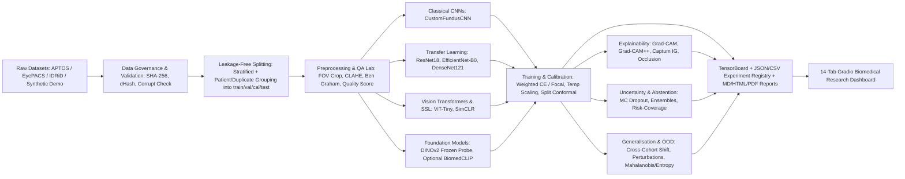

# RetinaX System Architecture

## 1. Design Philosophy

RetinaX enforces strict separation of concerns across data engineering, computer vision preprocessing, neural modeling, trustworthy uncertainty/explainability, experiment tracking, and the Gradio biomedical interface. No paid APIs, cloud GPUs, or proprietary databases are required; all components execute deterministically on a standard CPU-only laptop (e.g., 4-core Intel Core i5, 8 GB RAM).

## 2. Architecture Diagram

## 3. Memory & CPU Optimization Architecture

- **Lazy Image Loading:** `FundusDataset` decodes images on demand from disk (`num_workers=0` safe on macOS).
- **Pre-resized Disk Cache:** Repeated epochs read standardized PNGs cached under `data/processed/images/<config_hash>/`.
- **Frozen Embedding Caching:** High-parameter backbones (DINOv2 ViT-S/14, ViT-Tiny) extract features once to `.npz` archives under `experiments/cache/`, enabling millisecond linear/MLP probes.
- **CPU Thread Control:** `resolve_device_and_threads` tunes PyTorch intra-op threads and disables CUDA AMP cleanly on CPU.

## 4. Module Layout

- `src/data/`: Ingestion, synthetic phantom generator, SHA-256 + dHash duplicate validation, manifest serialization, leakage-free splitting, lazy PyTorch caching.
- `src/preprocessing/`: Classical OpenCV filters, FOV masking, Ben Graham illumination correction, Albumentations clinical augmentations, classical image quality proxy analyzer.
- `src/models/`: `CustomFundusCNN`, `ResNet18Classifier`, `EfficientNetB0Classifier`, `DenseNet121Classifier`, `ViTClassifier`, embedding probes, CPU inference engine, optional MONAI `LesionUNetWrapper`.
- `src/foundation/`: `SimCLREncoderModel` + NT-Xent pretraining, `DINOv2FeatureExtractor`, optional `BiomedCLIPExperiment`, PCA/t-SNE projection.
- `src/training/`: Class-weighted & Focal losses, differential LR optimizers, schedulers, reproducible checkpoints, TensorBoard `Trainer`.
- `src/evaluation/`: Multi-class/ordinal metrics (QWK, OvR AUROC/PR-AUC), Temperature Scaling & ECE, paired bootstrap CIs & McNemar test, perturbation stress & domain shift / OOD detection.
- `src/explainability/`: Hook-based Grad-CAM / Grad-CAM++, Captum Integrated Gradients & Occlusion Sensitivity, FOV attribution diagnostics.
- `src/uncertainty/`: Dropout-only MC inference, Deep Ensembles, Split Conformal Prediction (LAC/APS), Risk–Coverage abstention gates.
- `app/`: Modular 14-tab Gradio interface (`app/main.py`, `app/pages/`, `app/components/`).
